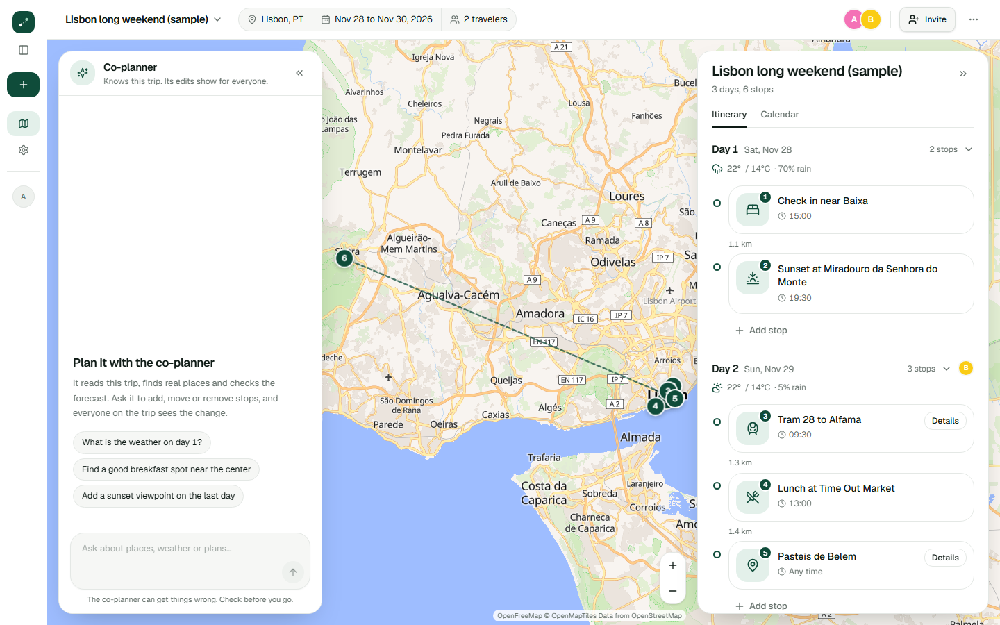
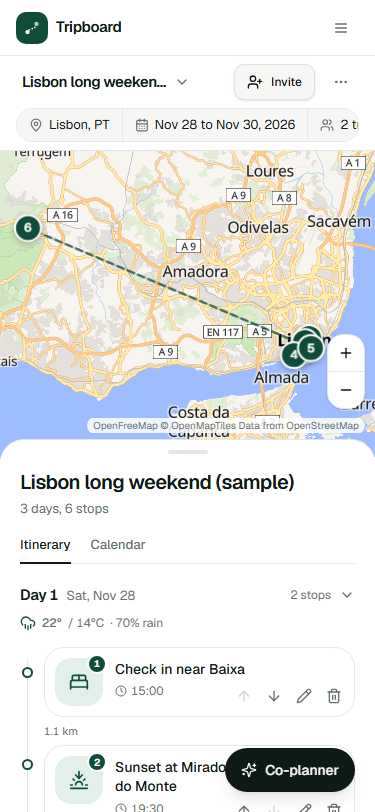

# Tripboard

A shared trip planner built on [DeepSpace](https://docs.deep.space). A group plans one trip together: the itinerary and an AI co-planner sit in two panels over a live map of the stops. The co-planner looks up real places and the forecast and edits the itinerary. It can only do what the person asking could do.

**Live:** https://tripboard-app.app.space (click "Start planning", sign in with Google or GitHub, then "Try a sample trip")



## What it does

- **An itinerary over a map.** Create a trip (name, destination, dates, up to 21 days). Days run down the itinerary panel (or a calendar view); add, edit, reorder and delete stops, or move one to another day. Stops are numbered on the map in day order, joined by a route line, with the distance between them in the itinerary. A stop you type in ("Lunch at Time Out Market") is placed on the map by a free OpenStreetMap lookup near the trip; a title with no place in it ("Dinner") stays off the map.
- **Built for phones too.** On a phone the map sits on top, the itinerary below it, and the co-planner opens as a bottom sheet.

  
- **Live with your group.** Every edit shows up for every member at once. Avatars show who is online, and each day shows who is looking at it right now.
- **Invite by link.** Any member can copy the trip's invite link. Opening it while signed in joins the trip.
- **Weather on each day.** A 16-day Open-Meteo forecast appears on the days inside the window. Days further out say when their forecast opens.
- **AI co-planner.** Each member gets a private chat for each trip. It reads the trip, searches places near the destination, reads the forecast and adds, moves or removes stops. Stops it adds carry an "Added by AI for <name>" badge for everyone.
- **Sample trip.** One click builds a 3-day Lisbon trip with 5 stops, so a reviewer gets a full board without typing.
- **Local agent tools.** The same tools work from Claude Code or any shell through `npx deepspace agent invoke`, and the open board updates live.

## Run it locally

Needs Node 22.15+ (or 24 or 26), npm 11.6+, and a DeepSpace account.

```sh
npm install
npx deepspace auth login
npx deepspace dev start      # vite + miniflare; open the URL it prints
npx deepspace dev kill       # stop it
```

Local dev calls the real integrations, owner-billed and capped (see [Spend](#integrations-and-zero-spend)). Tests never do.

```sh
npm run validate                 # tsc + vitest (50 unit tests)
npx deepspace test run all       # unit tests + Playwright (40 e2e tests), every external call mocked
npx deepspace test screenshot    # screenshots for a UI check
```

The Playwright suite signs in as four `@deepspace.test` accounts named Alex, Blair, Casey and Drew. Create them with `npx deepspace test accounts create --email <name>@deepspace.test --name "<Name>" --password-stdin`, or recover existing ones with `npx deepspace test accounts recover --all`.

## Architecture

One Cloudflare Worker (Hono) serves a Vite + React + Tailwind SPA and the API. All app data lives in one `AppRecordRoom` Durable Object (SQLite), keyed by the app id.

| Area | Files |
|---|---|
| Collections and RBAC | `src/schemas/trip-schemas.ts`, `ai-chat-schema.ts`, `users-schema.ts` |
| Server actions (privileged writes) | `src/actions/index.ts` |
| Membership checks, board writes | `src/server/board-services.ts` |
| Spend caps, geocoding, forecast | `src/server/trip-services.ts` |
| Place search (SerpApi, OpenStreetMap fallback), placing stops on the map | `src/server/places.ts` |
| AI tools, prompt, chat route, bounds | `src/ai/tools.ts`, `prompt.ts`, `chat-routes.ts`, `bounds.ts` |
| Presence and socket gates | `src/server/realtime-routes.ts` |
| Trip page: map, itinerary and co-planner panels | `src/pages/(app)/(protected)/trips/[tripId].tsx`, `src/components/trip/` (`TripMap.tsx`, `DayColumn.tsx`, `TripChat.tsx`) |
| App shell (sidebar) | `src/components/Navigation.tsx`, `src/components/shell/` |

### DeepSpace primitives used, and why

| Primitive | Used for | Why this and not something custom |
|---|---|---|
| `RecordRoom` collections, `useQuery` / `useMutations` | Trips, stops, members, chats | Live sync to every open tab with no hand-written WebSockets. RBAC runs in the Durable Object before anything is broadcast. |
| `'team'` permission level, `teamField`, a `team_members` collection | Trip membership | The platform resolves "is this caller on this trip" per row, so the board, the AI's reads and the socket all share one rule. |
| `immutable`, `userBound`, `writableFields`, `uniqueOn` | Write integrity | A member cannot move a stop into another trip, fake `addedBy`, or write the cached forecast. |
| Server actions (`/api/actions/<name>`) | Creating trips, stops, invites, joining, deleting, moving a stop to another day, placing a stop on the map, forecast refresh | Caller identity comes from the verified JWT. Each action checks membership and validates input before writing. |
| `usePresenceRoom('trip:<id>')` | Avatars and "looking at Day N" | Ephemeral, sub-second, identity from the JWT. Nothing stored. |
| `add ai-chat`: `ChatPanel`, `streamDeepSpaceAgent`, saved history | The co-planner | Streaming, tool calls and persistence come from the SDK. Changed for billing, caps and per-trip scope (below). |
| `registerAgent` + `buildTools` | One tool set for the in-app chat and local agents | Same code, same checks on both surfaces. |
| Integrations with `'developer'` billing | Geocoding, place search | Owner pays, the user never does, and calls run only in the worker. |
| `deepspace/testing` `users([...])` fixture | Multi-user Playwright tests | Real sign-ins as separate accounts in separate browser contexts. |

Not used on purpose: `YjsRoom` and `CanvasRoom` (records already sync per field), `JobRoom` and `CronRoom` (no background work yet), LiveKit, Stripe, email (an invite link does the job for free).

## Integrations and zero spend

The DeepSpace account is on the free tier: 500 one-time credits, no card on file. Real money cannot be spent. Development so far has used about 1.2 credits.

| Service | Used for | Cost | Where it runs |
|---|---|---|---|
| DeepSpace AI, `claude-haiku-5-5` | Co-planner turns | Token-priced, a real turn costs about 0.08 credits | `POST /api/ai/chat` |
| `openweathermap/geocoding` | Destination to coordinates, once per trip | about 0.2 credits | `createTrip` action |
| `serpapi/places-search` | Places with rating and address | 3.25 credits | `search_places` tool |
| OpenStreetMap Nominatim | Free place search fallback; placing hand-added stops on the map | free | `search_places` tool, `locateStop` action |
| Open-Meteo | 16-day daily forecast | free, no key | `refreshForecast` action and `get_forecast` tool |
| OpenFreeMap (MapLibre GL) | Map tiles for the trip page | free, no key | the browser, credited on the map |

How spend is kept at zero real money and bounded in credits:

- **Owner billing only.** `src/integrations.ts` sets `openweathermap` and `serpapi` to `'developer'`. The chat route calls `streamDeepSpaceAgent` without the caller's token, so turns bill the owner, never the user.
- **Server picks the model.** The chat route forces `claude-haiku-5-5` and ignores any client `modelId` (tested).
- **Worker only, behind sign-in.** The scaffold's browser integration proxy (`/api/integrations/:name/:endpoint`) returns 403. Paid calls run only inside actions and tools.
- **Atomic caps** (`reservePaidCall` in `src/server/trip-services.ts`). Every paid call first inserts its own row in the admin-only `usage` collection, then counts. Over a cap, it removes its row and refuses. Parallel calls can over-refuse but never over-grant. A failed write or count refuses (fail closed). Unit tests fire 50-call bursts through a fake room with random interleaving.
- **Caps per UTC day.** Per user: 15 chat turns, 3 new place searches, 10 geocodes, 20 trips, 60 map lookups (free, but polite to OpenStreetMap). App-wide: 40 credits across all paid calls, 20 of them for place searches. At 40 a day the free credits last at least 12 days even if every cap is hit.
- **Bounded chat turns** (`src/ai/bounds.ts`). Messages up to 2,000 characters, history window 8,000 characters, 4 tool calls, 1,024 output tokens per step, tool results capped at 4,000 characters, 40 stops in the prompt, no summarizer (no hidden second call). Each turn reserves 1.5 credits, its bounded worst case. When it ends, the row is settled to its token cost at prices set above what was billed (one measured turn: settled 0.155, billed 0.080).
- **One new place search per message.** Repeats are cached per trip and query.
- **Free fallback.** The platform's SerpApi account is out of searches, so SerpApi currently fails with a 429 and its charge is released. Search then falls back to Nominatim, bounded to about 15 km around the trip, one request per second app-wide, cached, credited "© OpenStreetMap contributors".
- **Graceful when credits run out.** A 402 or `insufficient_credits` anywhere in the error chain shows "The AI co-planner is out of credits for now. The board still works." Over a cap: a 429 with a plain message. Geocoding over cap still creates the trip, without weather.
- **Mocked tests.** Playwright runs set `MOCK_EXTERNAL_APIS` for `vite serve` only (never in a build). Geocoding, SerpApi, Nominatim and Open-Meteo return canned data inside the worker. The LLM is replaced at the model boundary by a scripted model (`src/ai/test-model.ts`), so the route, tools, caps and persistence under test are the real ones.

## RBAC, and why the AI cannot do more than its user

**Membership.** A trip's id doubles as its team id. A row passes `'team'` when the caller has an active `team_members` row for that trip. Trips, stops and the member list are all `'team'`-scoped. Non-members read zero rows.

**Creates go through actions.** In DeepSpace RBAC, `create` is a plain boolean with no row to check, so `'team'` cannot stop a non-member from writing a stop with someone else's `tripId`. Trips, stops, members and invites are `create: false` for every role and are created only by server actions that check membership first.

**What members can write directly** (over the socket, checked in the Durable Object):

- Stops: `position`, `title`, `notes`, `time`. A day change goes through the `moveStop` action, which checks the day is inside the trip. Coordinates are server-written. `tripId` and `addedBy` are immutable.
- Trips: `name` only. Coordinates and the cached forecast are server-written.
- Nothing else. `team_members`, `trip_invites`, `usage`, place caches, AI chats and messages are worker-written. Chat history is model input, so members cannot edit it.

**Joining is server-side.** Invite codes live in an admin-only collection. `joinTrip` looks up the code and writes the member row. A user cannot add themselves (the direct write is `CREATE DENIED`, tested).

**Privacy.** The users roster is `read-policy`, so each socket sees only its own user row. Co-member names are copied onto `team_members` when they create or join a trip. Trip presence rooms accept only members.

**The AI is bound to its user:**

- The chat and local agents run as the verified caller. Built-in tools are read-only (`records.query`, `records.get`, `schema.*`, `user.current`) and run through the caller's executor, so the room's RBAC applies to every read.
- Built-in record writes are not offered at all (`records_create` is a 404).
- Board writes use six custom tools (`get_trip`, `search_places`, `get_forecast`, `add_stop`, `move_stop`, `remove_stop`). They call the same services as the board's actions (`src/server/board-services.ts`): caller must be a member, the stop must belong to that trip, the day must be inside the trip.
- No tool can create invites, join a trip, add members or delete a trip. Those are actions the user takes in the UI.
- Paid tools reserve against the caller's own cap.
- Refusals are real HTTP statuses (403 not a member, 400 invalid, 404 not found, 429 over cap), so local agents see them too.

These services use the worker's privileged record tools, so the guarantee rests on their membership checks, not on the room's RBAC. Tests hold them to it. A non-member gets 403 "You are not a member of this trip" from every tool and from the chat route, and the trip is unchanged afterwards.

## Local agent tools

The worker serves the tools from `src/ai/tools.ts` through `registerAgent`. A local agent (Claude Code, Codex, a shell) uses the developer's CLI login.

```sh
npx deepspace agent tools tripboard-app --json
echo '{"tripId":"trip_...","day":"2026-11-28","title":"Added from Claude Code"}' > tool-input.json
npx deepspace agent invoke tripboard-app add_stop --input-file tool-input.json --json
```

The stop appears on every open board with the AI badge. Local agents get the read-only built-ins plus the six trip tools. The in-app chat gets only the six. A caller must have signed in to the app once (the SDK checks for a users row), and every tool checks trip membership. Invoking `add_stop` on someone else's trip returns `not_member`.

## Tests

- **Unit (vitest, 50):** caps under parallel bursts (per user, app ceiling, place ceiling, trip quota), settling to real cost, tool membership refusals that write nothing, move and reorder, time-ordered inserts, map placement matching, place cache and per-request limit, OSM fallback, out-of-credits detection, prompt and history bounds, integration parsers, trip dates, prerender.
- **End to end (Playwright, 40, all external calls mocked):**
  - Board flow: create, add, edit, reorder, delete.
  - Two members see each other live, with presence per day.
  - An excluded user cannot read, create, update or delete over the socket, the tools, the actions or presence.
  - Invite join, bad invite link.
  - AI-added stop appears live for another member with the badge.
  - Non-member chat and tool refusal, server-picked model.
  - Out-of-credits and real server cap 429s (chat and places).
  - OSM fallback with attribution.
  - Socket drop keeps the board and an open editor, forecast Retry, destination that cannot be geocoded.
  - Delete rules and cascade, scoped roster, phone drawer, smoke and SEO checks.

## Tradeoffs

- **Creates only through actions.** More code than `create: true`, but it is the only way to stop cross-trip writes, because `create` cannot be row-checked.
- **AI writes use privileged tools plus explicit checks**, not the caller's RBAC executor. That lets the tools validate days and assign positions, and create stops at all. The cost: correctness depends on `board-services.ts`, so every path there checks membership first, and tests cover non-members.
- **Caps favor refusing.** Insert-then-count can refuse a call during a burst that a lock would have allowed. It never lets one through past a cap. Settled chat costs run high (about 1.9x billed) on purpose.
- **Map placement from titles.** Free and keyless, but a guess. A result has to share a real word with the title, so a title like "Dinner" stays off the map instead of pinning a random restaurant.
- **Places quality.** SerpApi gives ratings, but the platform account is out of searches. OpenStreetMap is free and works, without ratings and with sparser coverage. The SerpApi parser follows the documented response shape and has not seen a live response.
- **Chat memory.** No summarizer keeps each turn cheap and bounded. Long chats forget their oldest turns.
- **Private chats.** Each member's co-planner chat is their own. Only its board edits are shared.
- **Forecast window.** Open-Meteo covers 16 days. Trips further out show no weather until their days come into range.
- **Names on member rows.** Copied at create or join time, so a renamed user shows the old name until they rejoin.

## What is left

- Manual pass on the live app with three sessions, including a phone, and a fresh Google sign-in as a reviewer would do it.
- Local agent demo against the live app with a board open.
- Map placement is a best guess: it needs a real place word in the title, can pick a same-named place within about 15 km, and a renamed stop keeps its old pin when the new title is not found.
- Time order applies when a stop is added. Editing a time later does not reorder the day (the arrows do).
- No e2e coverage yet for AI move and remove through the chat, or for using another user's chat id.
- `osm_slots` keeps one row per OpenStreetMap request (bounded by caps), with no cleanup.
- No way to remove a member, leave a trip or rotate an invite link.
- The main JS chunk is about 490 KB (about 150 KB gzipped). The landing page is prerendered HTML, so it paints before the JS loads; the map and chat load after the board.

## What is next

- "Plan the whole trip" as a `JobRoom` job whose progress every member watches.
- A `CronRoom` task that sends members the forecast two days before the trip.
- Member removal and invite rotation (the `removed` status already blocks rejoining).
- Drag and drop between days, photos for stops (Wikimedia, free), place search from the map.
- A daily cron to clear old `osm_slots` and `usage` rows.
